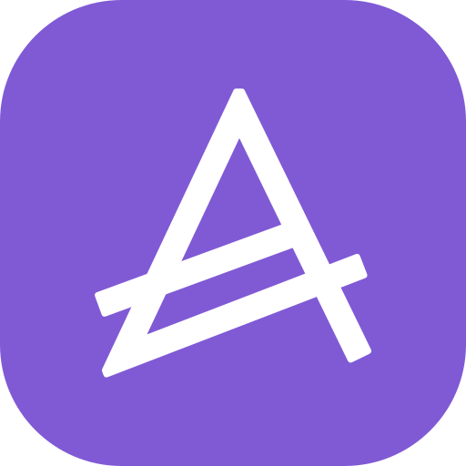

<p align="center">
  <picture>
    <source media="(prefers-color-scheme: dark)" srcset="assets/icon-dark.svg">
    
  </picture>
</p>

<h1 align="center">aac-actual-budget</h1>

<p align="center">Self-hosted deployment definition for Actual Budget, a private personal finance and budgeting server.</p>

<p align="center">
  <a href="https://github.com/actualbudget/actual"></a>
  
  <a href="https://github.com/actualbudget/actual/blob/master/LICENSE.txt"></a>
</p>

## About

Actual Budget is a local-first personal finance application. It keeps your budget on your own
server and syncs it across devices through a web interface, so the data stays under your
control. It follows the envelope budgeting approach: every unit of money is assigned to a
category before it is spent.

Key features (as provided by upstream):

- Envelope-style budgeting with categories, carry-over and goals
- Local-first data model with synchronization between devices
- Bank account synchronization and manual transaction entry
- Reports and account overviews
- Self-hosted server with a web interface
- Optional OpenID Connect login (this deployment is prepared for an OIDC identity provider)

## Upstream

- Project: <https://github.com/actualbudget/actual>
- Documentation: <https://actualbudget.org/docs>
- Container image: `actualbudget/actual-server:26.10.0-alpine` (Docker Hub)
- License: MIT (upstream project)

## Quick start (Docker Compose)

The Compose file is rendered from `service.yml` by the App-as-Code template engine. For a
manual run, the external networks used for routing must exist first:

```bash
docker network create services-secured
docker network create services-exposed
# "docker-default" is the default Docker network and normally already exists.

# Provide the values listed under "Configuration" in stack.env
docker compose up -d
```

Secrets are not stored in this repository. Provide them through the deployment pipeline or
create `stack.env` yourself (see below). Do not commit them.

## Configuration

Environment variables (defaults from `service.yml`; `CHANGE_ME` must be set per deployment):

| Variable | Default | Description |
|---|---|---|
| `PUID` | `1000` | User ID the container runs as |
| `PGID` | `1000` | Group ID the container runs as |
| `TZ` | `Europe/Berlin` | Time zone |
| `ACTUAL_OIDC_CLIENT_ID` | `CHANGE_ME` (secret) | OIDC client ID |
| `ACTUAL_OIDC_CLIENT_SECRET` | `CHANGE_ME` (secret) | OIDC client secret |
| `ACTUAL_OIDC_ISSUER_URL` | `CHANGE_ME` (secret) | OIDC issuer URL of the identity provider |

Ports:

| Port | Protocol | Purpose |
|---|---|---|
| `5006` | TCP | Web interface and sync server (`web`) |

Volumes:

| Mount | Description |
|---|---|
| `data` -> `/data` | User data of Actual Budget (budget files and server state) |

## Deploy with App-as-Code

1. Edit `service.yml`. It is the single source of truth for image, ports, environment,
   volumes, dependencies and per-stage overrides. Do not edit the rendered output.
2. Pushing to `main` (or a configured stage branch) runs the service pipeline, which renders
   the manifests with `aac-template-engine` and triggers the deployment.
3. Releases of this definition are published under <https://github.com/app-as-code/aac-actual-budget>.

## Credits and license

Actual Budget is developed by the Actual Budget project and licensed under MIT. This
repository only contains the deployment definition for it and is not a fork of the
application. The logo is provided by the selfh.st icon collection and the dashboard-icons
project; see [`assets/ICON_SOURCE.md`](assets/ICON_SOURCE.md) for icon sources and licenses.
